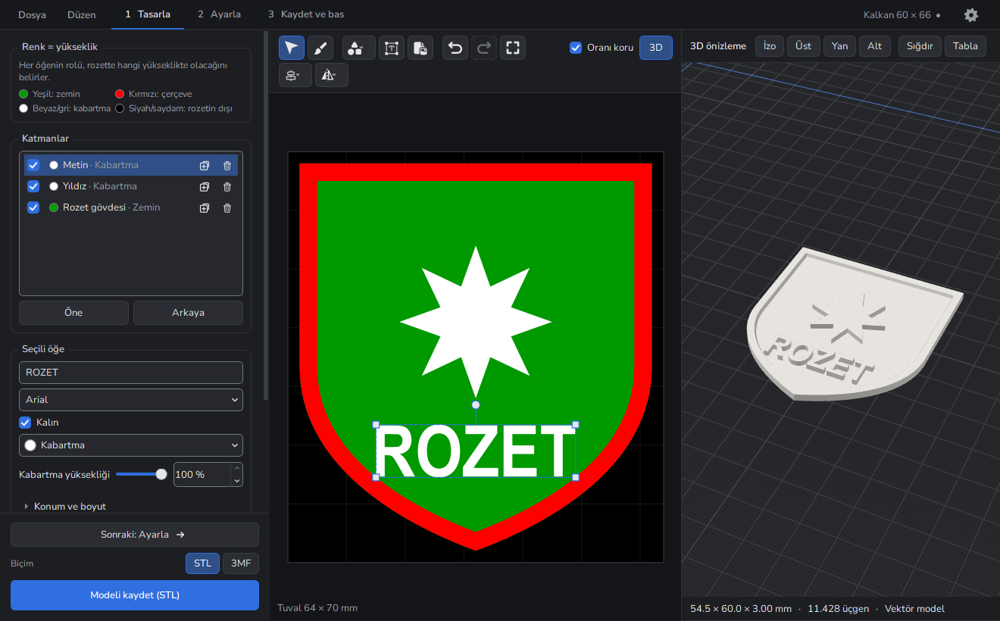
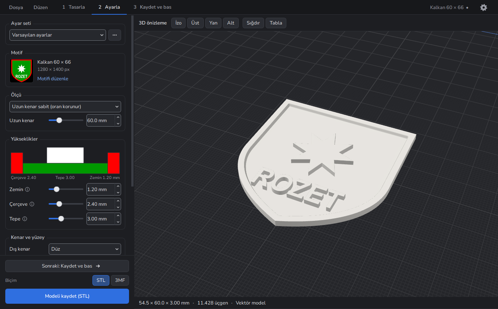
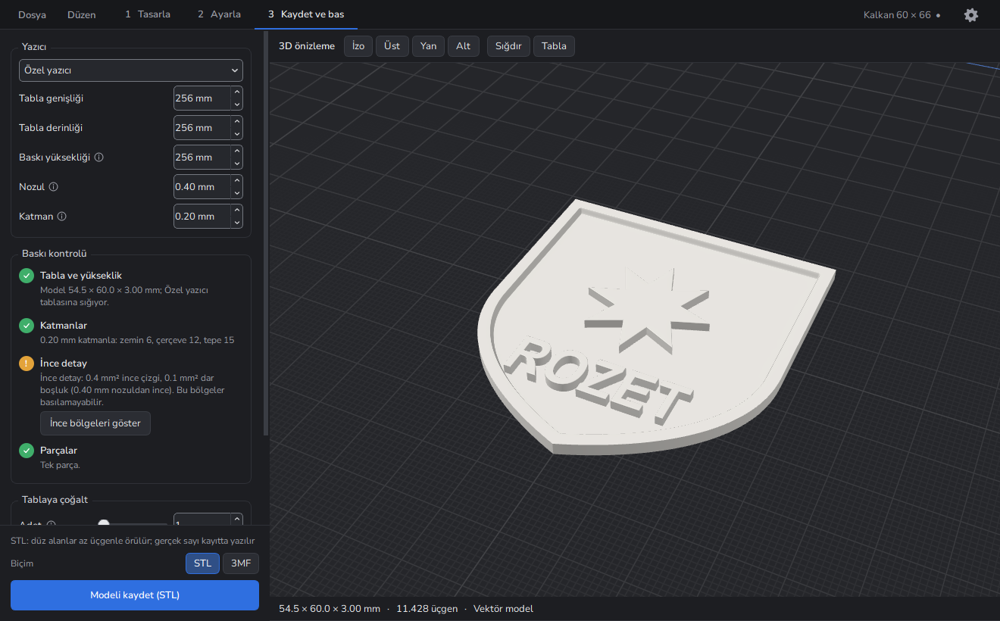

# Rozet Studio

Rozet, madalyon ve anahtarlık gibi küçük kabartmalı parçaları 3D baskıya hazırlayan bir Windows uygulaması. Motifinizi çizin, ölçüyü ayarlayın, STL ya da 3MF olarak kaydedip dilimleyicinizde açın.

## Nasıl çalışır

1. **Tasarla:** Şekil, yazı, fırça, SVG ya da resimle motifinizi oluşturun. Her renk bir yüksekliği temsil eder: zemin, çerçeve, kabartma.
2. **Ayarla:** Ölçüyü ve yükseklikleri seçin, modeli 3D önizlemede anında görün.
3. **Kaydet ve bas:** Yazıcınızı seçin, baskı kontrollerine göz atın, gerekirse tablaya çoğaltın ve kaydedin.

## İndirme

[Sürümler](../../releases/latest) sayfasından en son `Rozet-Studio.exe` dosyasını indirip çalıştırın. Kurulum ya da ek program gerekmez.

## Güncelleme

Program açılırken yeni sürüm olup olmadığına bakar ve varsa size sorar. Her sürümün yanında exe'nin SHA-256 özeti de bulunur; program indirdiği dosyayı bu özetle doğrular.
